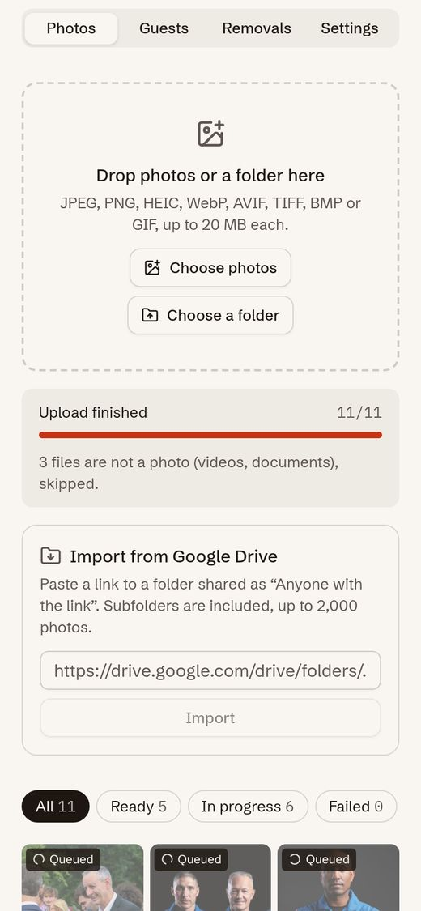
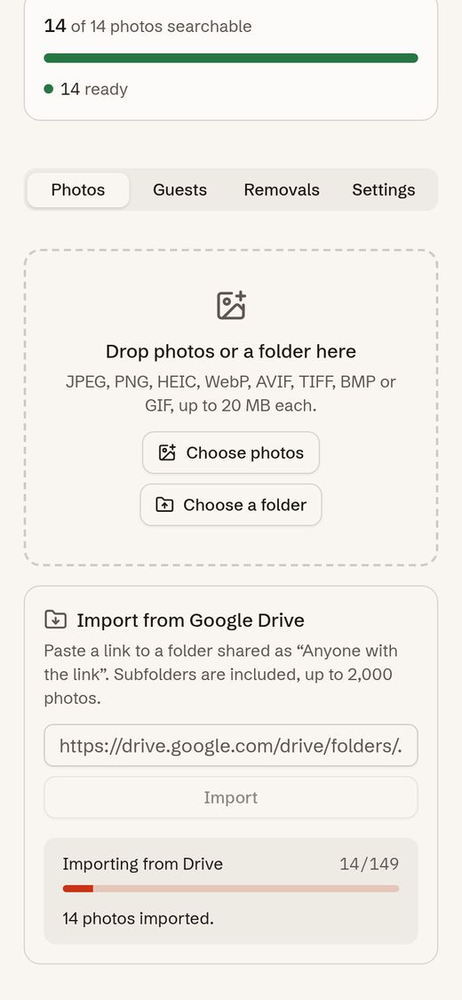
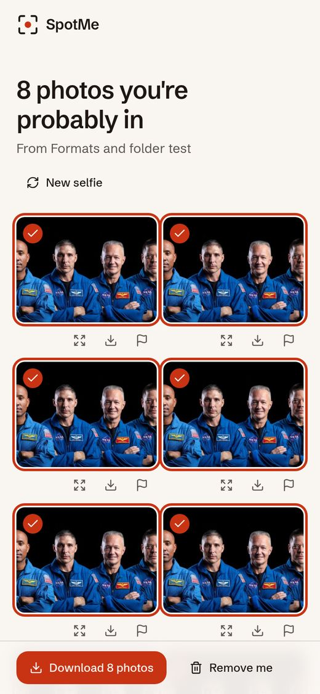

# SpotMe

**An event photo platform.** Organizers bring in an event's photos (upload, whole folders or a Google Drive
link) and every invited guest gets back only the photos they appear in, from one selfie.

SpotMe is built as a backend system: one Java 21 / Spring Boot application and PostgreSQL. The interesting
parts are the ones every photo product needs at scale: a durable job queue inside PostgreSQL, vector search
with pgvector, an ingestion pipeline that never trusts its input, organizer and guest auth, rate limits, privacy
flows with deletion that really deletes, and measurements on a real 473 MB server. Face matching is one module
that runs two pretrained OpenCV models as a library; nothing is trained.

**Live demo:** https://spotme.sites.tab.bot (tap *Try the demo*, then pick a sample selfie)

[](https://github.com/Darshan-dev57/spotme/actions/workflows/ci.yml)


<p>
  
  
  
  
</p>

A 40 second walkthrough of the guest and organizer flow is in [`docs/media/spotme-demo.mp4`](docs/media/spotme-demo.mp4).

## Contents

- [Backend highlights](#backend-highlights)
- [Architecture](#architecture)
- [How a photo moves through the system](#how-a-photo-moves-through-the-system)
- [The face matching module](#the-face-matching-module)
- [Features](#features)
- [Tech stack](#tech-stack)
- [Measured results](#measured-results)
- [Running locally](#running-locally)
- [Tests](#tests)
- [Project structure](#project-structure)
- [Screenshots](#screenshots)
- [Limits](#limits)
- [Documentation](#documentation)
- [Credits](#credits)
- [License](#license)

## Backend highlights

- **A job queue in PostgreSQL, no broker.** Workers claim jobs with `FOR UPDATE SKIP LOCKED`, hold a lease
  with a fresh claim token, retry with exponential backoff and jitter, and claim by priority so background
  imports never hold back indexing. A worker killed mid-batch: 438 of 438 photos ready, 0 duplicate faces,
  queue drained 60.4 s after restart.
- **Scale test on a 473 MB box.** 11,253 photos uploaded through the real API in 456 s (1,479.6 per minute)
  with 0 failed uploads and 0 server errors; the single worker kept up (largest queue: 24 jobs). One event now
  holds 11,251 photos and 12,940 faces.
- **A slow query found and fixed.** At that size the vector search took p50 129.5 ms in SQL. Materializing the
  query vector once and moving the distance limit into `WHERE` brought it to p50 7.3 ms, with identical results
  for all 678 searches that ran before the fix.
- **pgvector search scoped to one event.** Exact search inside an event, benchmarked against an HNSW index:
  0.63 ms p50 over 100,000 vectors with recall 1.0, where HNSW plus the event filter reached recall 0.411.
- **Ingestion that never trusts input.** File type from magic bytes, pixel cap read from the header before
  decoding, every photo re-encoded to JPEG (EXIF and GPS dropped), deduplicated by SHA-256. Eight formats,
  folder upload, and a keyless Google Drive import whose HTTP client only talks to Google's hosts (SSRF-safe).
- **Auth, limits and privacy.** Opaque session tokens stored as SHA-256 hashes, BCrypt passwords, per-guest
  and per-email rate limits, HMAC-signed expiring photo links, versioned consent, removal requests that hide
  at once, and an expiry purge that deletes files and vectors together.
- **Tested and deployed.** 107 backend tests (JUnit 5 and Testcontainers against real PostgreSQL) and 23 web
  tests run in GitHub Actions on every push; one script sets up the whole server from a bare Debian box.

## Architecture

```mermaid
flowchart TD

subgraph group_web["Web experience"]
  node_organizer["Organizer console<br/>[page.tsx]"]
  node_guest["Guest join and results<br/>[page.tsx]"]
end

subgraph group_events["Events and access"]
  node_api["REST API"]
  node_eventmgmt["Event and invites"]
  node_attendees["Consent and access"]
  node_auth["Sessions and auth"]
  node_session["Session service"]
end

subgraph group_ingest["Photo ingestion"]
  node_uploads["Photo upload"]
  node_intake["Validate and encode<br/>[PhotoIntake.java]"]
  node_drive["Drive import"]
  node_driveworker["Drive import jobs"]
  node_storage[("Photo files<br/>[PhotoStorage.java]")]
end

subgraph group_matching["Matching and jobs"]
  node_jobs[("Durable job queue<br/>[JobQueue.java]")]
  node_worker["Job workers<br/>[JobWorker.java]"]
  node_index["Photo indexing"]
  node_face["Face detection and vectors<br/>[FaceEngine.java]"]
  node_search["Event-scoped search<br/>[SearchService.java]"]
  node_results["Signed photo access<br/>[MediaSigner.java]"]
  node_alerts["New-photo alerts"]
end

subgraph group_privacy["Privacy lifecycle"]
  node_removal["Removal requests"]
  node_purge["Delete and expire<br/>[PurgeService.java]"]
end

node_db[("PostgreSQL + pgvector")]
node_organizer_actor(("Organizer"))
node_guest_actor(("Guest"))
node_drive_service["Google Drive"]

node_organizer_actor -->|"manages event"| node_organizer
node_guest_actor -->|"joins and searches"| node_guest
node_organizer -.->|"uses"| node_api
node_guest -.->|"uses"| node_api
node_api -.->|"routes requests"| node_eventmgmt
node_api -.->|"routes requests"| node_attendees
node_api -.->|"routes requests"| node_uploads
node_api -.->|"routes requests"| node_drive
node_api -.->|"routes requests"| node_search
node_api -.->|"routes requests"| node_removal
node_auth -->|"resolves token"| node_session
node_session -->|"reads and writes sessions"| node_db
node_uploads -.->|"validates photos"| node_intake
node_intake -.->|"stores clean images"| node_storage
node_intake -->|"photo row + index job"| node_jobs
node_drive -->|"queues listing"| node_jobs
node_driveworker -.->|"lists and downloads"| node_drive_service
node_driveworker -.->|"same checks as uploads"| node_intake
node_worker -->|"claims work"| node_jobs
node_worker -.->|"dispatches jobs"| node_index
node_worker -.->|"dispatches jobs"| node_driveworker
node_worker -.->|"dispatches jobs"| node_purge
node_index -.->|"embeds faces"| node_face
node_index -.->|"saves face vectors"| node_db
node_search -->|"embeds selfie"| node_face
node_search -->|"queries vectors"| node_db
node_search -.->|"returns matches"| node_results
node_results -.->|"signs media links"| node_storage
node_alerts -->|"finds new matches"| node_search
node_removal -->|"schedules deletion"| node_purge
node_purge -->|"queues and completes"| node_jobs
node_purge -->|"deletes files"| node_storage
node_purge -->|"deletes vectors and rows"| node_db

click node_organizer "https://github.com/darshan-dev57/spotme/blob/main/web/src/app/organizer/event/page.tsx"
click node_guest "https://github.com/darshan-dev57/spotme/blob/main/web/src/app/join/page.tsx"
click node_api "https://github.com/darshan-dev57/spotme/tree/main/backend/src/main/java/dev/darshan/spotme"
click node_eventmgmt "https://github.com/darshan-dev57/spotme/blob/main/backend/src/main/java/dev/darshan/spotme/event/EventController.java"
click node_attendees "https://github.com/darshan-dev57/spotme/blob/main/backend/src/main/java/dev/darshan/spotme/attendee/AttendeeController.java"
click node_auth "https://github.com/darshan-dev57/spotme/blob/main/backend/src/main/java/dev/darshan/spotme/auth/AuthInterceptor.java"
click node_session "https://github.com/darshan-dev57/spotme/blob/main/backend/src/main/java/dev/darshan/spotme/auth/SessionService.java"
click node_uploads "https://github.com/darshan-dev57/spotme/blob/main/backend/src/main/java/dev/darshan/spotme/media/UploadController.java"
click node_intake "https://github.com/darshan-dev57/spotme/blob/main/backend/src/main/java/dev/darshan/spotme/media/PhotoIntake.java"
click node_drive "https://github.com/darshan-dev57/spotme/blob/main/backend/src/main/java/dev/darshan/spotme/drive/DriveImportService.java"
click node_driveworker "https://github.com/darshan-dev57/spotme/blob/main/backend/src/main/java/dev/darshan/spotme/drive/DriveImportHandler.java"
click node_storage "https://github.com/darshan-dev57/spotme/blob/main/backend/src/main/java/dev/darshan/spotme/media/PhotoStorage.java"
click node_jobs "https://github.com/darshan-dev57/spotme/blob/main/backend/src/main/java/dev/darshan/spotme/jobs/JobQueue.java"
click node_worker "https://github.com/darshan-dev57/spotme/blob/main/backend/src/main/java/dev/darshan/spotme/jobs/JobWorker.java"
click node_index "https://github.com/darshan-dev57/spotme/blob/main/backend/src/main/java/dev/darshan/spotme/jobs/IndexPhotoHandler.java"
click node_face "https://github.com/darshan-dev57/spotme/blob/main/backend/src/main/java/dev/darshan/spotme/face/FaceEngine.java"
click node_search "https://github.com/darshan-dev57/spotme/blob/main/backend/src/main/java/dev/darshan/spotme/search/SearchService.java"
click node_results "https://github.com/darshan-dev57/spotme/blob/main/backend/src/main/java/dev/darshan/spotme/media/MediaSigner.java"
click node_alerts "https://github.com/darshan-dev57/spotme/blob/main/backend/src/main/java/dev/darshan/spotme/alerts/AlertController.java"
click node_removal "https://github.com/darshan-dev57/spotme/blob/main/backend/src/main/java/dev/darshan/spotme/removal/RemovalService.java"
click node_purge "https://github.com/darshan-dev57/spotme/blob/main/backend/src/main/java/dev/darshan/spotme/privacy/PurgeService.java"

classDef toneNeutral fill:#f8fafc,stroke:#334155,stroke-width:1.5px,color:#0f172a
classDef toneBlue fill:#dbeafe,stroke:#2563eb,stroke-width:1.5px,color:#172554
classDef toneAmber fill:#fef3c7,stroke:#d97706,stroke-width:1.5px,color:#78350f
classDef toneMint fill:#dcfce7,stroke:#16a34a,stroke-width:1.5px,color:#14532d
classDef toneRose fill:#ffe4e6,stroke:#e11d48,stroke-width:1.5px,color:#881337
classDef toneIndigo fill:#e0e7ff,stroke:#4f46e5,stroke-width:1.5px,color:#312e81
classDef toneTeal fill:#ccfbf1,stroke:#0f766e,stroke-width:1.5px,color:#134e4a
class node_organizer,node_guest toneBlue
class node_api,node_eventmgmt,node_attendees,node_auth,node_session,node_db toneAmber
class node_uploads,node_intake,node_drive,node_driveworker,node_storage toneMint
class node_jobs,node_worker,node_index,node_face,node_search,node_results,node_alerts toneRose
class node_removal,node_purge,node_organizer_actor,node_guest_actor,node_drive_service toneIndigo
```



<sub>Each box links to its source file.</sub>

One Spring Boot application holds all of the logic: the REST API, the job worker, the ingestion pipeline,
search and the privacy rules. The web UI is a static Next.js export served by the same application, so
production is a single process plus PostgreSQL. The same jar can also run as API only or worker only
(Spring profiles), because the queue lives in the database. A per-component view with the request paths is in
[docs/images/architecture.png](docs/images/architecture.png). The reasoning behind each choice is in
[docs/DECISIONS.md](docs/DECISIONS.md), and the components, data model and flows are in
[docs/ARCHITECTURE.md](docs/ARCHITECTURE.md).

## How a photo moves through the system

1. **Ingest.** Photos arrive one per request (the page sends 4 at a time, from files or whole folders) or from
   a Google Drive folder link, which becomes one background job per photo. Each photo is checked, re-encoded,
   stored, and a row plus its `INDEX_PHOTO` job are committed in one transaction.
2. **Index.** A worker claims the job with `SELECT ... FOR UPDATE SKIP LOCKED` and a lease, runs the face
   module, and saves one 128-number vector per face in a `vector(128)` column. Before saving it re-checks that
   the photo and event are still wanted and that its claim is still valid. If the worker dies, the lease runs
   out and another worker picks the job up.
3. **Invite.** The organizer publishes the event and creates one private link per guest.
4. **Consent.** The guest reads the organizer's purpose notice and agrees before anything else happens.
5. **Search.** The selfie must show exactly one clear face. One SQL query compares its vector with the faces of
   that event only, using pgvector's cosine distance, and the photos come back as short-lived signed links.
   The selfie is never stored.
6. **Remove and expire.** A guest can remove the photos where they are alone, or withdraw. Photos are hidden at
   once; the organizer approves deletion, which removes files, thumbnails and vectors. At expiry the whole
   event is purged by a job.

## The face matching module

The `face` package wraps two pretrained models from the OpenCV Zoo, run in-process through OpenCV's Java
bindings: YuNet finds faces and SFace turns each face into 128 numbers. No model is trained or fine-tuned
here. The backend work around it is choosing and measuring: the match threshold (0.51) was picked from a
sweep on the 11,251-photo event, where it cut strangers who got any photo from 17.6% to 3.7%, and the search
query, pool size and memory limits were tuned on the hosted box. Details in
[docs/MEASUREMENTS.md](docs/MEASUREMENTS.md).

## Features

**Organizers**
- Events with a purpose notice and an automatic deletion date (at most 90 days)
- Upload photos or a whole folder (subfolders included, drag and drop works too), 4 at a time, with duplicate
  detection and live indexing progress
- JPEG, PNG, HEIC/HEIF, WebP, AVIF, TIFF, BMP and GIF; every photo is stored as a clean JPEG
- Import a public Google Drive folder by pasting its link: no API key, subfolders included, runs as
  background jobs with progress
- Photos are private by default; select venue and crowd shots in bulk and make them public for every guest
- One private invite link per guest, with a QR code to download as a PNG, and revoke
- Review queue for removal requests: delete permanently or keep

**Guests**
- Consent to a versioned notice before searching
- One selfie: the phone's front camera, a live webcam preview on laptops, or a gallery photo; results in under a second
- Their own matches, plus an "Event photos" section with the photos the organizer shared with everyone
- Full-screen viewer, single downloads, or all their photos as one ZIP streamed by the server
- Opt-in "notify me": a private link that shows new photos of you as the organizer adds them
- "Not me" reports and consent withdrawal
- "Remove me": deletes the photos where you are alone, after the organizer confirms; group photos stay

## Tech stack

| Layer | Choice |
|---|---|
| Backend | Java 21, Spring Boot 4.1 (Web MVC, JDBC, Validation, Actuator), Flyway |
| Database | PostgreSQL 16 with pgvector |
| Faces | OpenCV 4.9 (Java bindings): YuNet for detection, SFace for 128-d embeddings |
| Frontend | Next.js 16 (static export), React 19, TypeScript, Tailwind CSS 4, shadcn-style components, ObsidianUI |
| Tests | JUnit 5, Testcontainers (real PostgreSQL), Vitest |
| Tooling | Maven, Docker Compose, GitHub Actions |

## Measured results

Every number below comes from a JSON file in [`eval/out/`](eval/out); how each was measured is in
[docs/MEASUREMENTS.md](docs/MEASUREMENTS.md). Accuracy uses LFW, a public face benchmark, arranged into a
438-photo test event.

| What | Result |
|---|---|
| Scale test upload, hosted box (2 vCPUs, 473 MB RAM) | 11,253 photos in 456.3 s (1,479.6 per minute), 0 failed, 0 server errors; queue empty 10 s after the last upload |
| Search SQL in the 11,251-photo event, before and after the query fix | p50 129.5 ms to 7.3 ms (p95 170.9 ms to 12.2 ms), same results |
| Search end to end on the hosted box, 11,251 photos | p50 163.1 ms, p95 246.9 ms from the client (1,733 searches) |
| Google Drive folder import, hosted box | 149 of 149 photos imported and indexed in 411.8 s, lowest free memory 56 MB |
| Folder upload in eight formats, hosted box | 11 of 11 uploaded, 3 non-photos skipped; one selfie found all 8 format copies |
| Worker killed mid-batch | 438 of 438 photos ready, 0 duplicate faces, queue drained 60.4 s after restart |
| Exact search inside one event (100,000 vectors) | p50 0.63 ms, recall 1.0, against HNSW plus event filter at recall 0.411 |
| Indexing throughput, development machine (2 worker threads x 2 OpenCV threads) | 582.4 photos per minute |
| Search latency, development machine (174 searches) | p50 59.2 ms, p95 79.7 ms |
| Match threshold 0.51, live on the 11,251-photo event | people with 10 to 15 photos: 680 of their 720 photos found; strangers who got any photo: 10 of 272 (17.6% at the old 0.55) |
| Accuracy at threshold 0.55 (small event, test split) | precision 0.9955, recall 0.8871; 0 of 25 people not in the event got a result |


## Running locally

**Requirements:** JDK 21, Maven 3.9+, Node.js 20+, Docker.

```bash
git clone https://github.com/Darshan-dev57/spotme.git
cd spotme

# 1. PostgreSQL 16 + pgvector on localhost:5434
docker compose up -d

# 2. Face models from the OpenCV Zoo (pinned commit, SHA-256 checked, about 39 MB)
./scripts/fetch-models.sh

# 3. Build the web UI into web/out
cd web && npm ci && npm run build && cd ..

# 4. Start the app (API, worker and web UI in one process)
cd backend
SPOTME_WEB_DIR=../web/out mvn spring-boot:run
```

Open http://localhost:8080, create an organizer account and an event, upload some photos, then open a guest
link from the *Guests* tab in a private window.

**Optional: the demo event.** Download the 36 public domain NASA photos and switch the demo on:

```bash
./scripts/fetch-demo-photos.sh
cd backend
SPOTME_WEB_DIR=../web/out SPOTME_DEMO_ENABLED=true SPOTME_DEMO_PHOTOSDIR=../data/demo-photos mvn spring-boot:run
```

**Working on the frontend.** Run the API alone and the Next.js dev server next to it:

```bash
cd backend && mvn spring-boot:run                              # API on :8080
cd web && NEXT_PUBLIC_API_URL=http://localhost:8080 npm run dev  # UI on :3000
```

Every `spotme.*` setting in
[`application.properties`](backend/src/main/resources/application.properties) can be overridden with an
environment variable, for example `SPOTME_WORKER_THREADS=4`. The `api` and `worker` profiles split the
HTTP server and the indexing worker into separate processes.

## Tests

```bash
cd backend && mvn verify     # unit and integration tests; Testcontainers starts PostgreSQL in Docker
cd web && npm test           # Vitest
cd web && npm run lint
```

The integration tests run against a real PostgreSQL with pgvector and real face models. They cover the
upload checks, the job queue under concurrent workers, recovery after a worker is killed mid-batch, event
scoping of search, consent and withdrawal, removal and purge, expiry, signed links, the demo event, every
server-side image format (uploaded, indexed and found by a selfie) and the Drive import (with Google's
answers faked, so it runs offline).
CI runs the same commands on every push.

## Project structure

```
backend/        Spring Boot application (package dev.darshan.spotme)
  auth/         organizer accounts, sessions, access rules
  event/        events, notices, invites, review and removal decisions
  media/        upload checks, re-encoding, storage, signed links
  jobs/         job queue, worker loop, indexing, housekeeping
  drive/        Google Drive folder import (listing, downloads, import jobs)
  face/         OpenCV YuNet + SFace engine and pool
  search/       selfie rules and event-scoped vector search
  attendee/     guest API: consent, search, download, removal, withdrawal
  privacy/      purge of photos and events
  demo/         optional public demo event
web/            Next.js frontend (static export)
eval/           measurement scripts and their results (eval/out)
deploy/         packaging and start script for a single small Linux box
docs/           architecture, decisions, measurements, diagrams
scripts/        model and demo photo downloads
```

## Screenshots

| | | |
|---|---|---|
|  |  |  |
| A folder uploaded, non-photos skipped | Importing a Google Drive folder | One selfie, found in all eight formats |
|  |  |  |
| Photos indexed and searchable | One private link per guest | Reviewing a removal request |
|  |  |  |
| The notice a guest agrees to | Photos the guest is probably in | Full-screen viewer |
|  |  |  |
| Choosing what to remove | Sample selfies in the demo | Home page |
|  |  | |
| Opting in to new-photo alerts | The private link with new photos | |

## Limits

- Accuracy is measured on LFW composites, which are mostly frontal and well lit. Real event photos (turned
  heads, blur, small faces in crowds) will give lower recall.
- One machine: photo files are on local disk and rate limits are in memory. Several API instances would need
  shared storage and a shared rate limit store.
- Exact search is fast for thousands of faces per event; an event with millions of faces would need
  partitioning or a filtered vector index.
- New-photo alerts are in the app only: a guest sees them by opening their private link, nothing is pushed.
- Guests can't be erased from group photos; removal takes only the photos where they are alone. The inpainting
  test behind that choice is in [docs/MEASUREMENTS.md](docs/MEASUREMENTS.md).
- Drive import reads Google's embedded folder page, which is not an official API and can change; only folders
  shared as "Anyone with the link" work.
- HEIC and AVIF photos are converted by the organizer page, so they must be uploaded there (not straight to
  the API). Animated GIFs keep only their first frame.
- Invite links are not tied to a verified identity. A forwarded link works until the organizer revokes it,
  and a match is a likely match, not proof of identity.

The full list, with numbers, is in [docs/ARCHITECTURE.md](docs/ARCHITECTURE.md#limits).

## Documentation

- [docs/ARCHITECTURE.md](docs/ARCHITECTURE.md): components, data model, the five main flows, security model, hosting
- [docs/DECISIONS.md](docs/DECISIONS.md): twenty-four design decisions with the alternative, the tradeoff and what would change them
- [docs/MEASUREMENTS.md](docs/MEASUREMENTS.md): how every number was measured and how to reproduce it
- [eval/README.md](eval/README.md): the evaluation dataset and scripts

## Credits

- UI components: [ObsidianUI](https://www.obsidianui.dev/) (Discover Button) and shadcn-style primitives
  built on [Radix UI](https://www.radix-ui.com/)
- Face models: [OpenCV Zoo](https://github.com/opencv/opencv_zoo), YuNet (MIT) and SFace (Apache 2.0)
- HEIC decoding in the browser: [heic-to](https://github.com/hoppergee/heic-to) (LGPL-3.0, built on libheif),
  loaded as a separate file only when a HEIC photo is picked
- Demo photos: [NASA Image and Video Library](https://images.nasa.gov/), public domain
- Evaluation data: [Labeled Faces in the Wild](http://vis-www.cs.umass.edu/lfw/), used only as a public
  benchmark and never committed

## License

[MIT](LICENSE)

SpotMe is a personal project. It is not affiliated with any company or product of the same name.
