# SpotMe

Find your photos from a private event with one selfie.

An organizer uploads the event's photos and a background worker indexes the faces. Each invited guest
agrees to a short notice, takes one selfie and gets back the photos they are probably in, from that event
only. The selfie is used for that one search and then discarded; a guest who opts in to new-photo alerts has
only their face vector kept until the event ends.

**Live demo:** https://spotme.sites.tab.bot (tap *Try the demo*, then pick a sample selfie)

[](https://github.com/Darshan-dev57/spotme/actions/workflows/ci.yml)


<p>
  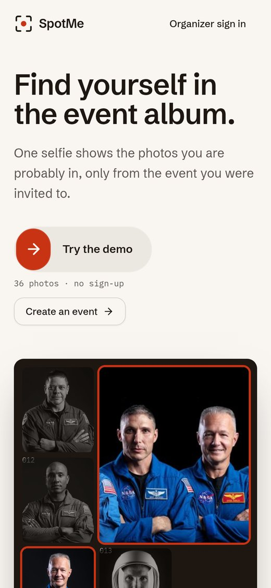
  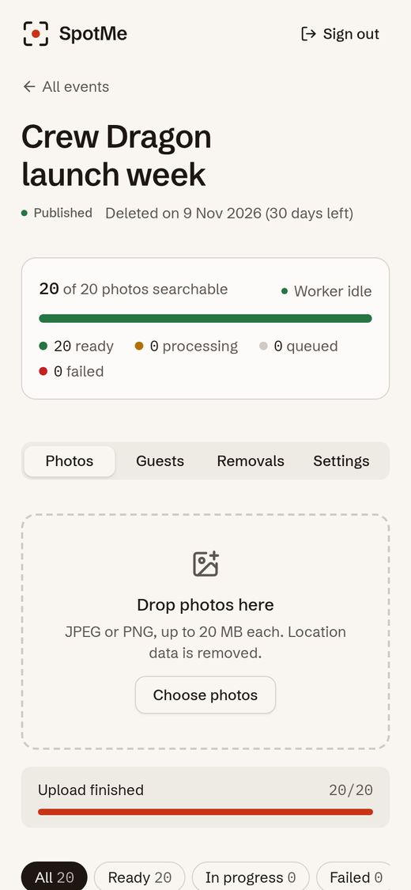
  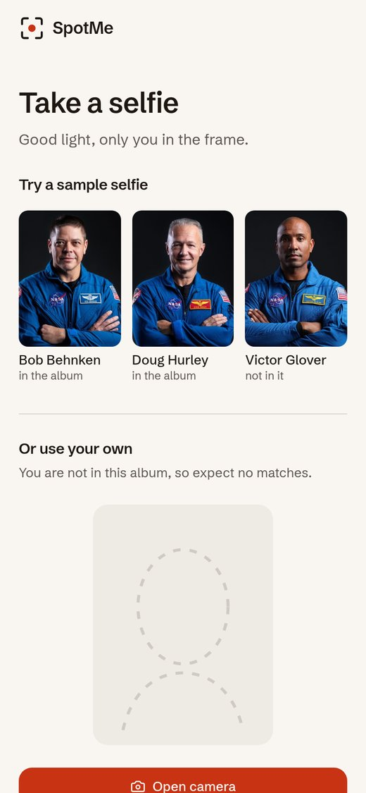
  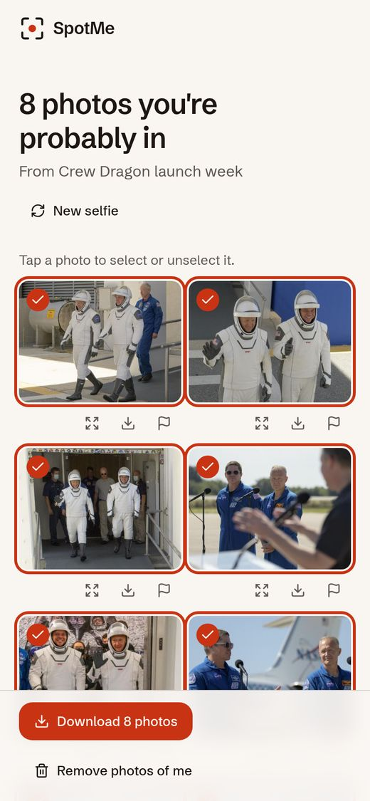
</p>

A 40 second walkthrough of the whole flow is in [`docs/media/spotme-demo.mp4`](docs/media/spotme-demo.mp4).

## Contents

- [How it works](#how-it-works)
- [Features](#features)
- [Tech stack](#tech-stack)
- [Measured results](#measured-results)
- [Running locally](#running-locally)
- [Tests](#tests)
- [Project structure](#project-structure)
- [Screenshots](#screenshots)
- [Limits](#limits)
- [Documentation](#documentation)
- [Credits](#credits)
- [License](#license)

## How it works

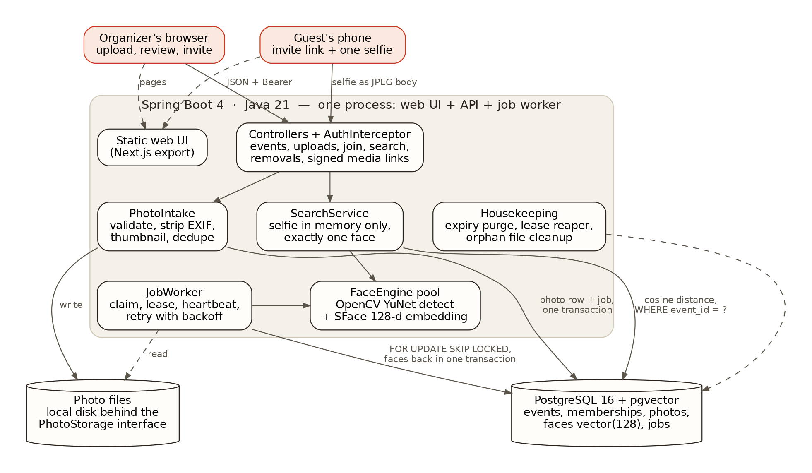

1. **Upload.** The organizer uploads photos. Each one is checked (type from its bytes, size and pixel caps),
   re-encoded to strip location data, stored, and a job is added to a queue table in PostgreSQL.
2. **Index.** A worker claims jobs with `SELECT ... FOR UPDATE SKIP LOCKED` and a lease, finds faces with
   OpenCV YuNet, turns each face into a 128-number vector with SFace, and stores the vectors with pgvector.
   If the worker dies, the lease runs out and another worker picks the job up again.
3. **Invite.** The organizer publishes the event and creates one private link per guest.
4. **Consent.** The guest reads the organizer's purpose notice and agrees before anything else happens.
5. **Search.** The guest's selfie must show exactly one clear face. Its vector is compared with the faces of
   that one event only, and photos closer than a measured threshold come back as short-lived signed links.
6. **Remove.** A guest can remove the photos where they are alone (group photos stay), or withdraw consent.
   The photos are hidden at once; the organizer approves deletion, which removes the files, thumbnails and
   face vectors.

Java and Spring Boot hold all of the logic: the API, the job queue, the face pipeline, search and privacy
rules. The web UI is a static Next.js export served by the same application, so production is a single
process plus PostgreSQL. The reasoning behind each choice is in [docs/DECISIONS.md](docs/DECISIONS.md).

## Features

**Organizers**
- Events with a purpose notice and an automatic deletion date (at most 90 days)
- Upload photos or a whole folder (subfolders included, drag and drop works too), 4 at a time, with duplicate
  detection and live indexing progress
- JPEG, PNG, HEIC/HEIF, WebP, AVIF, TIFF, BMP and GIF; every photo is stored as a clean JPEG
- One private invite link per guest, with revoke
- Review queue for removal requests: delete permanently or keep

**Guests**
- Consent to a versioned notice before searching
- One selfie (camera or gallery), results in under a second
- Full-screen viewer, single downloads or a ZIP of selected photos
- Opt-in "notify me": a private link that shows new photos of you as the organizer adds them
- "Not me" reports and consent withdrawal
- "Remove me": deletes the photos where you are alone, after the organizer confirms; group photos stay

**Engineering**
- Durable job queue in PostgreSQL: leases, retries with backoff, idempotent indexing, crash recovery
- Event-scoped exact vector search, benchmarked against HNSW
- Opaque session tokens stored as SHA-256 hashes, BCrypt passwords, rate limits
- HMAC-signed, expiring photo links
- Expiry sweep and purge that remove files and vectors together

## Tech stack

| Layer | Choice |
|---|---|
| Backend | Java 21, Spring Boot 4.1 (Web MVC, JDBC, Validation, Actuator), Flyway |
| Database | PostgreSQL 16 with pgvector |
| Faces | OpenCV 4.9 (Java bindings): YuNet for detection, SFace for 128-d embeddings |
| Frontend | Next.js 16 (static export), React 19, TypeScript, Tailwind CSS 4, shadcn-style components, ObsidianUI |
| Tests | JUnit 5, Testcontainers (real PostgreSQL), Vitest |
| Tooling | Maven, Docker Compose, GitHub Actions |

## Measured results

Every number below comes from a JSON file in [`eval/out/`](eval/out); how each was measured is in
[docs/MEASUREMENTS.md](docs/MEASUREMENTS.md). Accuracy uses LFW, a public face benchmark, arranged into a
438-photo test event.

| What | Result |
|---|---|
| Match threshold 0.51, live on an 11,251-photo event | people with 10 to 15 photos: 680 of their 720 photos found; strangers who got any photo: 10 of 272 (17.6% at the old 0.55) |
| Accuracy at threshold 0.55 (small event, test split) | precision 0.9955, recall 0.8871; 0 of 25 people not in the event got a result |
| Search latency (development machine, 174 searches) | p50 59.2 ms, p95 79.7 ms |
| Indexing throughput (2 worker threads x 2 OpenCV threads) | 582.4 photos per minute |
| Worker killed mid-batch | 438 of 438 photos ready, 0 duplicate faces, queue drained 60.4 s after restart |
| Exact search inside one event (100,000 vectors) | p50 0.63 ms, recall 1.0, against HNSW plus event filter at recall 0.411 |
| Hosted demo box (2 vCPUs, 473 MB RAM), 36 photos | all indexed 6.4 s after the first upload; search p50 166.1 ms from the client |

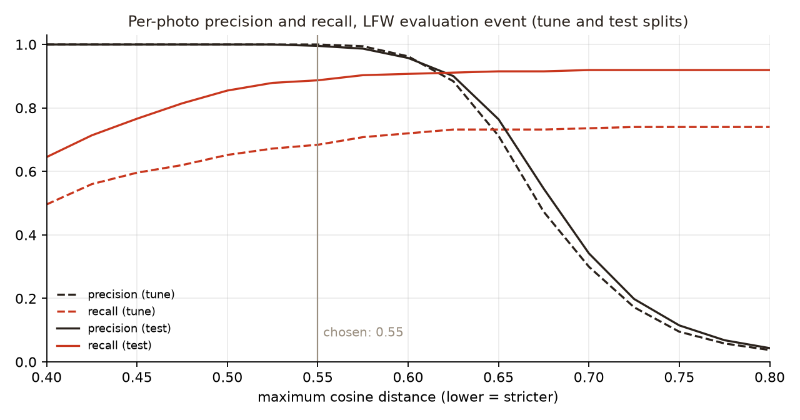

## Running locally

**Requirements:** JDK 21, Maven 3.9+, Node.js 20+, Docker.

```bash
git clone https://github.com/Darshan-dev57/spotme.git
cd spotme

# 1. PostgreSQL 16 + pgvector on localhost:5434
docker compose up -d

# 2. Face models from the OpenCV Zoo (pinned commit, SHA-256 checked, about 39 MB)
./scripts/fetch-models.sh

# 3. Build the web UI into web/out
cd web && npm ci && npm run build && cd ..

# 4. Start the app (API, worker and web UI in one process)
cd backend
SPOTME_WEB_DIR=../web/out mvn spring-boot:run
```

Open http://localhost:8080, create an organizer account and an event, upload some photos, then open a guest
link from the *Guests* tab in a private window.

**Optional: the demo event.** Download the 36 public domain NASA photos and switch the demo on:

```bash
./scripts/fetch-demo-photos.sh
cd backend
SPOTME_WEB_DIR=../web/out SPOTME_DEMO_ENABLED=true SPOTME_DEMO_PHOTOSDIR=../data/demo-photos mvn spring-boot:run
```

**Working on the frontend.** Run the API alone and the Next.js dev server next to it:

```bash
cd backend && mvn spring-boot:run                              # API on :8080
cd web && NEXT_PUBLIC_API_URL=http://localhost:8080 npm run dev  # UI on :3000
```

Every `spotme.*` setting in
[`application.properties`](backend/src/main/resources/application.properties) can be overridden with an
environment variable, for example `SPOTME_WORKER_THREADS=4`. The `api` and `worker` profiles split the
HTTP server and the indexing worker into separate processes.

## Tests

```bash
cd backend && mvn verify     # unit and integration tests; Testcontainers starts PostgreSQL in Docker
cd web && npm test           # Vitest
cd web && npm run lint
```

The integration tests run against a real PostgreSQL with pgvector and real face models. They cover the
upload checks, the job queue under concurrent workers, recovery after a worker is killed mid-batch, event
scoping of search, consent and withdrawal, removal and purge, expiry, signed links and the demo event.
CI runs the same commands on every push.

## Project structure

```
backend/        Spring Boot application (package dev.darshan.spotme)
  auth/         organizer accounts, sessions, access rules
  event/        events, notices, invites, review and removal decisions
  media/        upload checks, re-encoding, storage, signed links
  jobs/         job queue, worker loop, indexing, housekeeping
  face/         OpenCV YuNet + SFace engine and pool
  search/       selfie rules and event-scoped vector search
  attendee/     guest API: consent, search, download, removal, withdrawal
  privacy/      purge of photos and events
  demo/         optional public demo event
web/            Next.js frontend (static export)
eval/           measurement scripts and their results (eval/out)
deploy/         packaging and start script for a single small Linux box
docs/           architecture, decisions, measurements, diagrams
scripts/        model and demo photo downloads
```

## Screenshots

| | | |
|---|---|---|
|  |  | 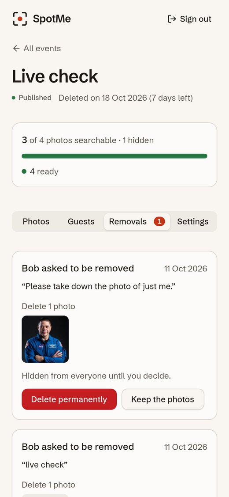 |
| Photos indexed and searchable | One private link per guest | Reviewing a removal request |
| 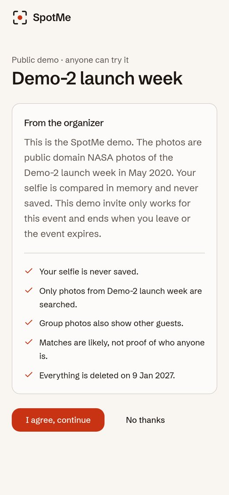 |  |  |
| The notice a guest agrees to | Photos the guest is probably in | Full-screen viewer |
| 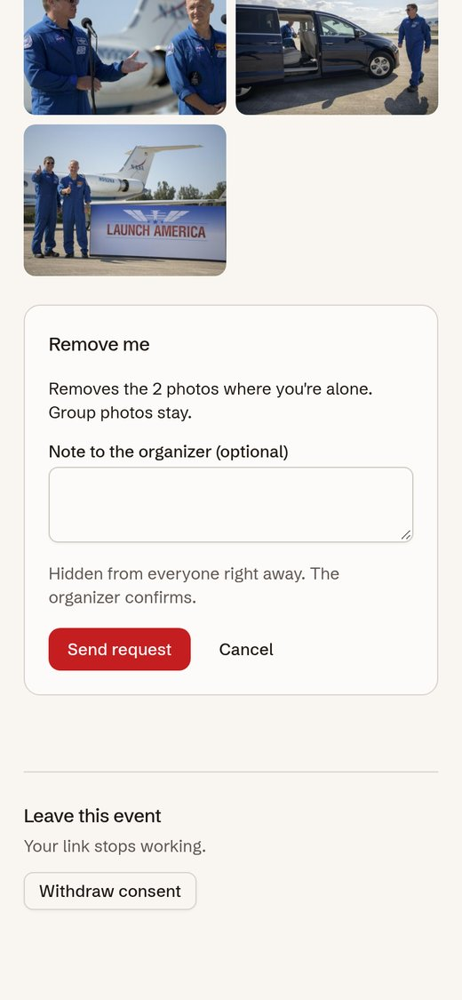 |  |  |
| Choosing what to remove | Sample selfies in the demo | Home page |
| 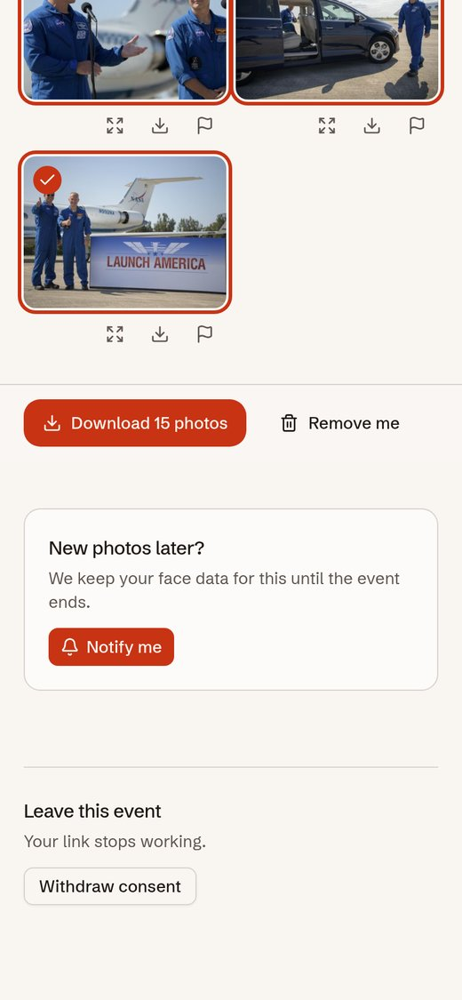 | 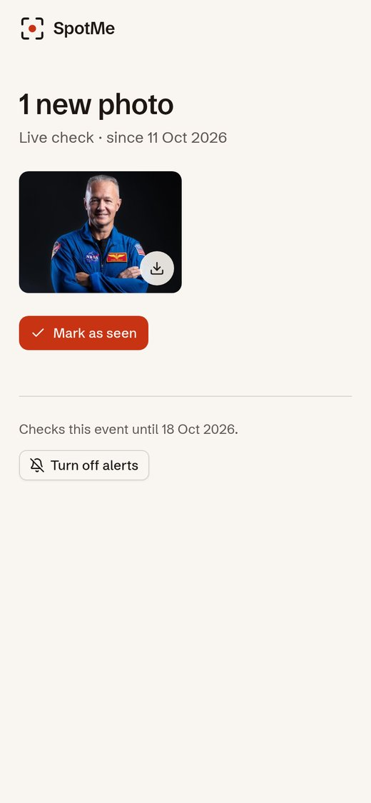 | |
| Opting in to new-photo alerts | The private link with new photos | |

## Limits

- Accuracy is measured on LFW composites, which are mostly frontal and well lit. Real event photos (turned
  heads, blur, small faces in crowds) will give lower recall.
- One machine: photo files are on local disk and rate limits are in memory. Several API instances would need
  shared storage and a shared rate limit store.
- Exact search is fast for thousands of faces per event; an event with millions of faces would need
  partitioning or a filtered vector index.
- New-photo alerts are in the app only: a guest sees them by opening their private link, nothing is pushed.
- Erasing a guest from group photos is built but switched off: the inpainting it needs looks natural only when
  the person stands apart, and needs about 1 GB of memory ([test results](docs/MEASUREMENTS.md)).
- HEIC and AVIF photos are converted by the organizer page, so they must be uploaded there (not straight to
  the API). Animated GIFs keep only their first frame.
- Invite links are not tied to a verified identity. A forwarded link works until the organizer revokes it,
  and a match is a likely match, not proof of identity.

The full list, with numbers, is in [docs/ARCHITECTURE.md](docs/ARCHITECTURE.md#limits).

## Documentation

- [docs/ARCHITECTURE.md](docs/ARCHITECTURE.md): components, data model, the four main flows, security model, hosting
- [docs/DECISIONS.md](docs/DECISIONS.md): twenty-two design decisions with the alternative, the tradeoff and what would change them
- [docs/MEASUREMENTS.md](docs/MEASUREMENTS.md): how every number was measured and how to reproduce it
- [eval/README.md](eval/README.md): the evaluation dataset and scripts

## Credits

- UI components: [ObsidianUI](https://www.obsidianui.dev/) (Discover Button) and shadcn-style primitives
  built on [Radix UI](https://www.radix-ui.com/)
- Face models: [OpenCV Zoo](https://github.com/opencv/opencv_zoo), YuNet (MIT) and SFace (Apache 2.0)
- Demo photos: [NASA Image and Video Library](https://images.nasa.gov/), public domain
- Evaluation data: [Labeled Faces in the Wild](http://vis-www.cs.umass.edu/lfw/), used only as a public
  benchmark and never committed

## License

[MIT](LICENSE)

The organizer page loads [heic-to](https://github.com/hoppergee/heic-to) (LGPL-3.0, built on libheif) as a
separate file, only when a HEIC photo is picked. The face models are OpenCV Zoo's YuNet (MIT) and SFace (Apache 2.0).

SpotMe is a personal project. It is not affiliated with any company or product of the same name.
