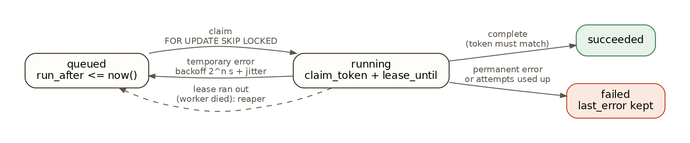
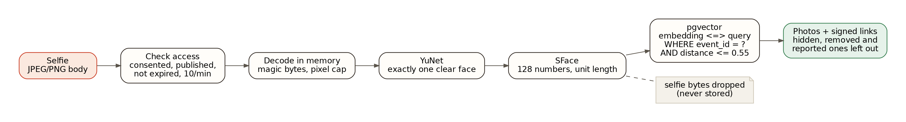
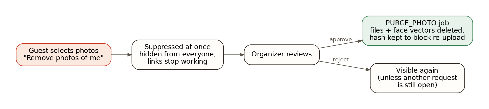

# Architecture

SpotMe is one Spring Boot application backed by one PostgreSQL database. The web UI is a static Next.js
export that the same application serves, so in production a single process answers everything.

## Contents

- [Components](#components)
- [Data model](#data-model)
- [Flow 1: an organizer uploads photos](#flow-1-an-organizer-uploads-photos)
- [Flow 2: the worker indexes a photo](#flow-2-the-worker-indexes-a-photo)
- [Flow 3: a guest searches with a selfie](#flow-3-a-guest-searches-with-a-selfie)
- [Flow 4: removal, withdrawal and expiry](#flow-4-removal-withdrawal-and-expiry)
- [Flow 5: importing a Google Drive folder](#flow-5-importing-a-google-drive-folder)
- [Security and privacy model](#security-and-privacy-model)
- [Process roles and configuration](#process-roles-and-configuration)
- [Hosted deployment](#hosted-deployment)
- [Measured numbers](#measured-numbers)
- [Limits](#limits)

## Components

| Package | Responsibility |
|---|---|
| `auth` | Organizer accounts (BCrypt), opaque bearer sessions stored as SHA-256 hashes, the interceptor that decides which token may call which path |
| `event` | Events, the purpose notice, publishing, invites, review (hide / unhide), removal decisions |
| `media` | `PhotoIntake` (validate, re-encode, thumbnail, store, enqueue), `ImageProcessor` (six formats decoded on the server), `PhotoStorage`, signed media links |
| `jobs` | The Postgres job queue, the worker loop, the indexing handler, housekeeping (lease reaper, expiry sweep, orphan files) |
| `face` | `FaceEngine` (OpenCV YuNet + SFace) and a small pool so a fixed number of engines are shared by threads |
| `search` | Selfie rules (exactly one clear face) and the event-scoped distance query |
| `attendee` | The guest API: notice, consent, search, download as ZIP, wrong-match reports, removal requests, withdrawal |
| `privacy` | `PurgeService`: deleting one photo or a whole event, files and vectors included |
| `drive` | Google Drive folder import: link parsing, the locked-down HTTP client, the listing and per-photo jobs |
| `demo` | The optional public demo event and its per-visitor invites |
| `eval` | An owner-only endpoint that returns raw distances, enabled only by the `eval` profile |
| `config`, `common` | Settings (`spotme.*`), serving the web UI, error JSON, rate limiting, token helpers |

## Data model

All state is in PostgreSQL. The schema is in
[`V1__init.sql`](../backend/src/main/resources/db/migration/V1__init.sql), with later changes in the
other files of [`db/migration`](../backend/src/main/resources/db/migration).

| Table | Holds | Notes |
|---|---|---|
| `organizers` | email, display name, BCrypt hash | email is unique and stored lower case |
| `events` | title, purpose notice + version, status, expiry, `deletion_epoch`, `demo` | status: `draft`, `published`, `deleting`, `purged`; expiry at most 90 days out |
| `memberships` | one row per invited guest: label, hash of the invite token, consent version, withdrawal, revocation | the invite token itself is never stored |
| `sessions` | hash of a bearer token, organizer or membership, expiry | exactly one of the two owners is set (a `CHECK` constraint) |
| `photos` | storage keys, SHA-256 of the uploaded bytes, size, status, `hidden_at`, `suppressed_at`, `is_public`, face count | `UNIQUE (event_id, content_sha256)` dedupes uploads |
| `faces` | box, detection score, `embedding vector(128)`, `model_version` | indexed on `(event_id, model_version)`; no face exists outside its event |
| `jobs` | kind, target, dedupe key, state, priority, attempts, `run_after`, `lease_until`, `claim_token` | partial indexes for claiming and for expired leases; Drive import jobs have priority 1, everything else 0 |
| `drive_imports` | event, Drive folder id, status, files found, skipped, over the limit, error | one running import per event |
| `drive_import_files` | one photo in an import: Drive file id, name, type, status, resulting photo, error | `UNIQUE (import_id, file_id)` |
| `guest_matches` | photo ids the guest's last search returned (no selfie, no vector), replaced on every search | checks what a ZIP may contain |
| `removal_requests` | the solo photos to delete, note, decision | |
| `photo_alerts` | one guest's face vector, hash of the alert link token, `seen_until` | only after the guest opts in; deleted with the event, on withdrawal, revocation, a notice change or when turned off |
| `wrong_match_reports` | guest + photo | hides that photo from that guest's results only |
| `worker_heartbeats` | worker id, last seen, jobs done | drives the "worker active" badge on the organizer page |

## Flow 1: an organizer uploads photos

1. The web page sends each file as its own request, 4 at a time, so one bad file never fails a batch. The
   organizer can pick photos, pick a whole folder (`<input webkitdirectory>`) or drop a folder; the page walks
   every subfolder, sends only photo files and counts the rest (videos, documents, hidden system files) as
   skipped. Once the server answers `event_full`, the rest of a big folder is not sent.
2. `PhotoIntake` hashes the bytes. A file already in the event returns `duplicate`; a file that was removed on
   request is refused (`removed_photo`). An event holds at most `spotme.upload.max-photos-per-event` photos.
3. `ImageProcessor` reads the real type from the first bytes (JPEG, PNG, WebP, TIFF, BMP or GIF), reads only
   the header to check the pixel count against `spotme.upload.max-pixels`, then decodes (at most
   `max-concurrent-decodes` at a time; OpenCV for most formats, Java's ImageIO for the first frame of a GIF),
   re-encodes to JPEG, which drops EXIF data such as GPS position, and makes a 480 px thumbnail. HEIC/HEIF and
   AVIF photos are turned into JPEG by the web page before upload; sent straight to the API they get a clear
   `unsupported_type` message. A photo over the pixel cap is sent again by the page as a 4000 px copy.
4. Both files are written under keys built from generated ids. Then one transaction inserts the photo row
   (`queued`) and its `INDEX_PHOTO` job. If the transaction fails, the files are deleted; if the process dies
   in between, the orphan sweeper deletes them after 15 minutes.

## Flow 2: the worker indexes a photo

1. Each worker thread claims a job:
   `UPDATE jobs ... WHERE id IN (SELECT id FROM jobs WHERE state = 'queued' AND run_after <= now() ORDER BY priority, run_after, id LIMIT n FOR UPDATE SKIP LOCKED)`,
   setting `state = 'running'`, a 60 s lease and a new random `claim_token`.
2. The slow half runs with no transaction open: read the file, scale it so the long side is at most 1280 px,
   detect faces with YuNet (score 0.8 or higher, at least 40 px), align and crop each face, and embed it with
   SFace into 128 numbers normalised to unit length.
3. The fast half is one transaction. It locks the photo row and re-checks that the photo is still wanted
   (still `processing`, not suppressed, the event still live and its `deletion_epoch` unchanged). Only then are
   the photo's old faces deleted, the new ones inserted and the job completed, and completion only succeeds
   if the `claim_token` still matches. Otherwise the result is discarded.
4. Errors: a permanent one (damaged image, missing file) fails the photo at once with a reason the organizer
   sees; a temporary one is retried with exponential backoff and jitter, up to 5 attempts, capped at 5 minutes.
5. Every 5 seconds the reaper returns jobs whose lease has expired to the queue, so a worker that died
   mid-photo costs at most one lease of delay.

## Flow 3: a guest searches with a selfie

1. The guest opens `/join#<token>`. The page calls `GET /api/join/{token}` and shows the organizer's notice,
   what happens to the selfie, and the deletion date.
2. Agreeing (`POST /api/join/{token}/consent`) records the notice version and returns a guest session.
3. `POST /api/attendee/search` takes the selfie as the raw request body (the page shrinks it in the browser
   first). The session is re-checked on every call: consented to the current notice, not withdrawn, not
   revoked, event published and not expired. Searches are limited to 10 per guest per minute.
4. The selfie is decoded in memory and must contain exactly one clear face: none is refused, and a second face
   at least a quarter of the size of the largest is refused too, so the app never guesses whose photos to show.
5. One SQL query compares the vector with every face in that event using pgvector's cosine distance operator
   `<=>`, keeps photos whose closest face is within 0.51 (decision 7), and leaves out hidden, suppressed and
   reported-by-this-guest photos.
6. The response lists photo ids with signed thumbnail and download links valid for 10 minutes, a flag when
   some photos are still being indexed, and a `Server-Timing` header with the decode, face and SQL times.
   The selfie bytes are dropped when the request ends.
7. `GET /api/attendee/event-photos` pages through the photos the organizer marked public (60 at a time), with
   the same signed links. Private photos only ever come back through step 5.
8. "Download all" asks `POST /api/attendee/download-link` for a two-minute signed link to `/api/zip/{membershipId}`,
   which streams a ZIP of the photos in `guest_matches` that are still visible, one file at a time
   (decision 26). Three ZIPs per guest per minute, two at once on the server.

## Flow 4: removal, withdrawal and expiry

- **Removal request:** photos where the guest is the only face are suppressed for everyone at once; group
  photos stay (decision 21). Approval enqueues a `PURGE_PHOTO` job that deletes both files and all face vectors
  and marks the row `purged`, keeping only the content hash so the same file cannot be uploaded again.
  Rejection lifts the suppression unless another open request still covers the photo.
- **Wrong match:** hides the photo from the reporting guest only and counts it for the organizer.
- **New-photo alerts:** a guest who opts in after a search gets a private link; opening it searches the event
  for photos indexed after `seen_until` with the kept vector. Turning alerts off, withdrawing, revocation, a
  notice change and the event purge all delete the vector.
- **Withdrawal:** the guest's sessions are deleted and the invite stops working.
- **Expiry:** every minute the sweeper starts deletion for events past `expires_at`. Deletion bumps the
  `deletion_epoch` (so in-flight indexing results are thrown away), then a `PURGE_EVENT` job removes files,
  vectors, photos, memberships and requests, leaving a tombstone event row with status `purged`.

## Flow 5: importing a Google Drive folder

No Google API key and no Google account are involved; the folder must be shared as "Anyone with the link".

1. The organizer pastes a folder link. `DriveLinks` accepts only `https://drive.google.com/...` folder links
   and takes out the folder id. `POST /api/events/{id}/drive-imports` saves a `drive_imports` row (`listing`)
   and a `DRIVE_LIST` job in one transaction, and refuses a second import while one is running.
2. `DRIVE_LIST` reads `https://drive.google.com/embeddedfolderview?id=<folder>`, the page Google serves for
   embedding a shared folder, and parses one entry per file or subfolder (id, name, type). Subfolders are read
   breadth first, up to 5 levels and 50 folders. Non-image files are counted as skipped, photos past 2,000 as
   over the limit. One transaction saves a `drive_import_files` row and a `DRIVE_FILE` job per photo.
3. Each `DRIVE_FILE` job imports one photo, so memory stays flat on the small box. A type the server reads
   (JPEG, PNG, WebP, TIFF, BMP, GIF) is downloaded from `drive.google.com/uc?export=download&id=<file>` and
   handed to `PhotoIntake`, the same path as an upload. When the original is over 20 MB, over the pixel cap,
   or a type the server can't read (HEIC, camera RAW), Google's own JPEG rendering
   (`lh3.googleusercontent.com/d/<file>=s4000`, at most 4000 px on the longest side) is used instead.
4. The file row becomes `imported`, `duplicate` or `failed` with a reason, and the import is `done` when no
   file is left queued. The page polls `GET /api/events/{id}/drive-imports` every 3 seconds for the counts.
5. Import jobs have priority 1 and the claim orders by priority first, so each imported photo is indexed
   right after it arrives and an organizer's own uploads never wait behind a big import.

The HTTP client follows redirects by hand and checks every hop: https only, port 443, and only the hosts
`drive.google.com`, `drive.usercontent.google.com` and `lh3.googleusercontent.com`. It has a 10 s connect and
30 s request timeout and stops reading a body past the byte limit, so a pasted link can't make the server fetch
anything else (SSRF) or fill its memory.

## Security and privacy model

| Concern | How it is handled |
|---|---|
| Who can search | Only a guest with a personal invite who agreed to the current notice, for a published, unexpired event |
| Scope | Every face row carries its `event_id`; the search query always filters by the guest's event |
| Selfies | Never written to disk or the database; error logs carry only the exception type and message. A guest who opts in to alerts has the vector (not the image) kept until the event ends |
| Credentials | Session and invite tokens are random (256 bits) and stored as SHA-256; invite tokens travel after `#` |
| Passwords | BCrypt; 10 login attempts per email per minute; the same answer for unknown email and wrong password |
| Photo access | HMAC-signed links with subject and expiry, plus a live access check when the link is used |
| Uploads | Type from magic bytes, pixel cap before decoding, re-encode strips EXIF, generated storage keys |
| Drive import | Only Google's hosts over https, every redirect checked, timeouts and a byte limit; nothing else is fetched |
| Retention | Expiry at most 90 days; purge removes files and vectors; removal requests hide photos immediately |
| Organizer duty | Creating an event requires confirming that everyone pictured is an adult and has agreed |

The threats behind this table, and the test for each defence, are in [THREAT_MODEL.md](THREAT_MODEL.md).

## Process roles and configuration

| Profile | Runs | Typical use |
|---|---|---|
| (default) | API, worker and sweepers in one process | local development, the hosted demo |
| `api` | HTTP only, `spotme.worker.enabled=false` | scale the API separately |
| `worker` | job loop and sweepers, no web server | a separate indexing machine |
| `eval` | adds the owner-only raw distance endpoint | the measurement scripts only |

Every `spotme.*` setting in
[`application.properties`](../backend/src/main/resources/application.properties) can be overridden with an
environment variable (for example `SPOTME_WORKER_THREADS`).

## Hosted deployment

The public demo runs on a single Debian 12 box with 473 MB of memory and 2 vCPUs, behind
https://spotme.sites.tab.bot. `deploy/package.sh` builds a 33 MB folder (unpacked app, web UI, demo photos,
scripts) and `deploy/start.sh` runs on the box:

1. adds a 1 GB swap file,
2. installs PostgreSQL 16 and pgvector from the PostgreSQL apt repository if missing, applies small memory
   settings (`shared_buffers` 32 MB, 20 connections) and creates the database, user and `vector` extension,
3. downloads a Java 21 runtime (Eclipse Temurin), the OpenCV jar from Maven Central and the two face models,
   checking SHA-256 where the source publishes one,
4. starts the app with one face engine, one worker thread, a 128 MB heap, a 16 megapixel cap, at most 2,000
   photos per event and the demo event switched on.

Every step checks what is already present, so a restart takes seconds.

## Measured numbers

Details and method: [MEASUREMENTS.md](MEASUREMENTS.md).

| What | Result | Source |
|---|---|---|
| Accuracy on the LFW test split at 0.55 | precision 0.9955, recall 0.8871, 0 of 25 absent people matched | `accuracy.json` |
| Threshold 0.51, 11,251-photo event, live | 680 of 720 photos found for people with 10 to 15 photos; 10 of 272 strangers got a photo | `scale_person_051.json` |
| Search latency, development machine | p50 59.2 ms, p95 79.7 ms (face step p50 30.1 ms, SQL p50 16.9 ms) | `latency.json` |
| Indexing throughput, 2 x 2 threads | 582.4 photos per minute (438 photos, 807 faces) | `indexing.json` |
| Crash in the middle of a batch | 438 of 438 photos ready, 0 duplicate faces, drained 60.4 s after restart | `indexing.json` |
| Exact search in one event, 100,000 vectors | p50 0.63 ms, recall 1.0 (HNSW with the event filter: recall 0.411) | `ann_bench.json` |
| Hosted box, 36 photos | all indexed 6.4 s after the first upload; search p50 166.1 ms from the client | `hosted.json` |
| Hosted box, scale test upload | 11,253 photos in 456.3 s (1,479.6 per minute), 0 failed, 0 server errors | `scale.json` |
| Hosted box, search SQL at 11,251 photos | p50 129.5 ms before the query fix, 7.3 ms after | `scale.json` |
| Hosted box, folder in eight formats | 11 of 11 uploaded, 3 non-photos skipped, the selfie found all 8 format copies | `ingest_live.json` |
| Hosted box, Drive folder of 149 photos | 149 of 149 imported and indexed in 411.8 s, lowest free memory 56 MB | `ingest_live.json` |

## Limits

- **Accuracy is measured on a benchmark, not on real events.** LFW composites are mostly frontal, well-lit
  faces; real event photos have turned heads, motion blur, sunglasses and small faces in crowds, so expect
  lower recall. Recall on the tune split was 0.684.
- **One machine.** Photo files are on local disk and the rate limiters are in memory, so running two API
  instances needs shared storage and a shared rate limit store.
- **Exact search grows with event size.** Fine for hundreds or thousands of faces per event (under a
  millisecond in the benchmark); a single event with millions of faces would need partitioning or a
  filtered index.
- **The hosted box is small.** Peak memory while indexing (467 to 493 MB) is about the same as its 473 MB of
  RAM, so it relies on swap; photos are capped at 16 megapixels and 2,000 per event there.
- **Drive import depends on a Google page.** The embedded folder page is not an official API and can change.
  A folder of 149 photos (13 plus a 136-photo subfolder) listed whole; whether a single folder with several
  hundred files lists in one page has not been tested. The import uses one worker thread and Google's
  download speed, so a 2,000-photo folder takes a while.
- **Alerts are pull, not push.** A guest who opts in sees new photos when they open their private link; nothing
  is sent to them.
- **Guests cannot be erased from group photos.** Removal takes only their solo photos (decision 21).
- **HEIC and AVIF need the web page.** The server has no decoder for them, so the browser converts them; a
  browser without a HEIC or AVIF decoder shows a message asking for JPEG. Animated WebP is refused and an
  animated GIF keeps only its first frame.
- **Guests are not identity-checked.** A forwarded invite works for whoever holds it until the organizer
  revokes it. Matches are likely matches, not proof of identity.
